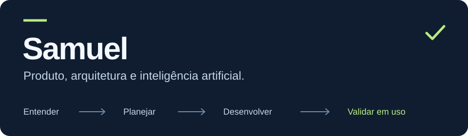
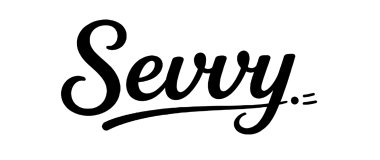
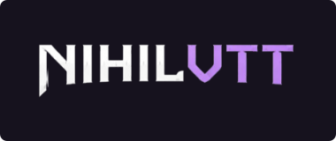
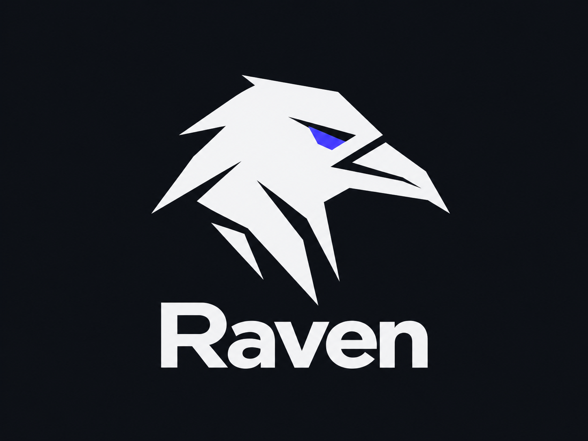

# Olá, eu sou Samuel ✌️

Sou estudante de **Engenharia de Software** e trabalho no desenvolvimento de produtos com **inteligência artificial**, do entendimento da necessidade à validação com o cliente. Estou construindo a **[Nihilsoftware](https://www.instagram.com/nihilsoftware/)**, minha software house.

Me interesso especialmente por **arquitetura de software**, **modelagem de domínio** e pela relação entre decisões técnicas e o funcionamento de um produto na prática.

## Projeto principal: Sevvy

A **Sevvy** está em operação comercial e reúne a experiência de compra do cliente e as ferramentas de gestão de pedidos para lojistas, com aplicação web, backend e app Android em uma plataforma multiloja.

**Stack do projeto:** Next.js · React · TypeScript · React Native · Expo · Kotlin · PostgreSQL · Drizzle ORM.

**[Conheça a Sevvy ↗](https://www.sevvy.com.br/)** · Código-fonte privado.

## Projeto paralelo: NIHILVTT

O **NIHILVTT** é um Virtual Tabletop para sessões de RPG online, em **desenvolvimento secundário**, voltado à exploração de automação de regras, modelagem de domínio, estado compartilhado e sincronização em tempo real.

**Stack do projeto:** React · TypeScript · Vite · Tailwind CSS · PixiJS · Zustand · Java · Spring Boot · PostgreSQL.

## Skill de planejamento: Raven

A **Raven** é uma skill de planejamento crítico para agentes de IA: questiona a raiz do problema, testa premissas e ajuda a alinhar o escopo antes da implementação, com confirmação do entendimento e plano em Markdown opcional.

**Formato do projeto:** Skill em Markdown · Metadados para Codex · Validação com Python e GitHub Actions.

**[Conheça a Raven ↗](https://github.com/nihilboy1/Raven)** · Código aberto sob licença MIT.

---

💬 Fique à vontade para conversar comigo sobre engenharia de software, arquitetura e desenvolvimento de produtos.
